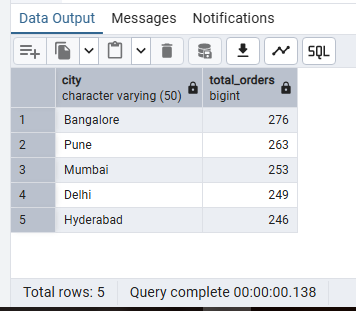
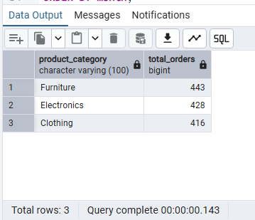
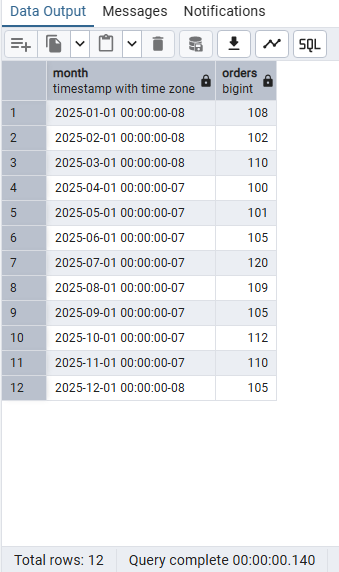
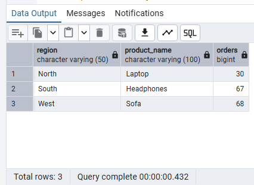
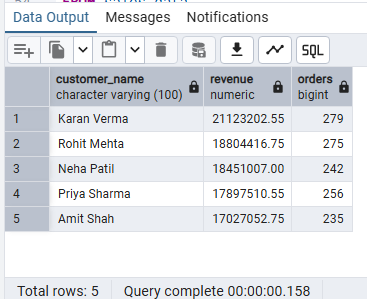
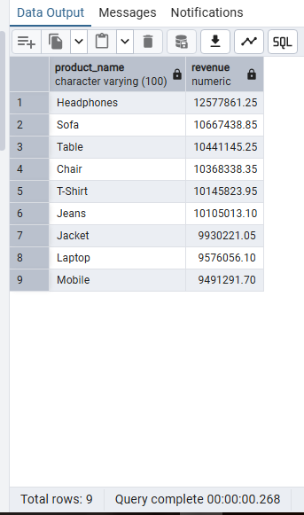
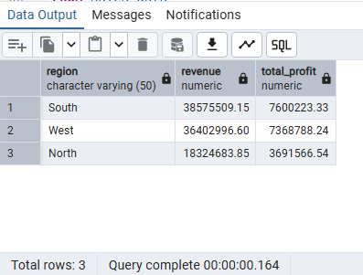
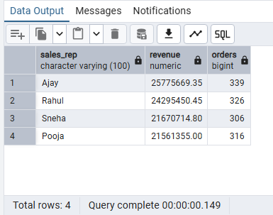
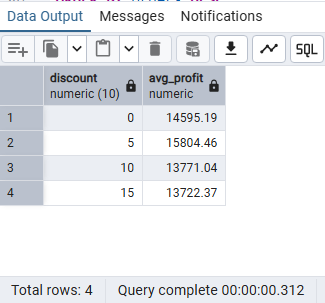
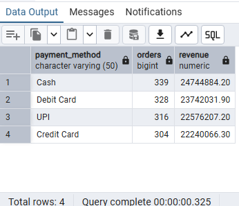

# Sales Data Analysis using PostgreSQL

## Objective
Analyze sales, profit and trends of **1,287 orders (Jan–Dec 2025)** using SQL, and turn the results into clear business recommendations.

## Dataset
One table, `sales_data`, with these columns:
`order_id`, `order_date`, `customer_name`, `city`, `region`, `product_category`, `product_name`, `sales_rep`, `units_sold`, `unit_price`, `total_sales`, `payment_method`, `discount`, `profit`

## Tools Used
PostgreSQL, pgAdmin 4, Microsoft Excel

## SQL Skills Used
`SELECT`, `WHERE`, `GROUP BY`, `ORDER BY`, aggregate functions (`SUM`, `COUNT`, `AVG`, `MIN`, `MAX`), `ROUND`, `DATE_TRUNC`, subqueries, window function (`RANK() OVER (PARTITION BY ...)`)

---

## Data Cleaning
Before the analysis, I checked the data quality:

1. **City spelling check:** 5 unique cities (Bangalore, Delhi, Hyderabad, Mumbai, Pune), no spelling issues.
2. **Date range check:** orders run from January 2025 to December 2025.
3. **NULL / invalid values check:** no NULL values and no zero or negative sales found (query returned 0 rows).

**Result:** the data is clean and ready for analysis.

---

## Business Analysis

### 1. City-wise Orders
**Problem:** Which city gives us the most orders?
```sql
SELECT city, COUNT(*) AS total_orders
FROM sales_data
GROUP BY city
ORDER BY total_orders DESC;
```


**Insight:** Bangalore leads with 276 orders and Hyderabad is last with 246. The gap is only 30 orders (about 12%), so all five cities perform similarly.

**Solution:** Study what works in Bangalore (offers, marketing, delivery) and repeat it in Hyderabad and Delhi.

---

### 2. Category-wise Orders
**Problem:** Which product category sells the most?
```sql
SELECT product_category, COUNT(*) AS total_orders
FROM sales_data
GROUP BY product_category
ORDER BY total_orders DESC;
```


**Insight:** Furniture is first with 443 orders (34.4%), then Electronics (428) and Clothing (416). The gap between first and last is only 27 orders, so demand is well balanced.

**Solution:** Keep stock and marketing balanced across all three categories, and run seasonal offers on Clothing to bring it level with Furniture.

---

### 3. Month-wise Trend
**Problem:** How do orders change through the year?
```sql
SELECT DATE_TRUNC('month', order_date) AS month, COUNT(*) AS orders
FROM sales_data
GROUP BY month
ORDER BY month;
```


**Insight:** Monthly orders stay between 100 and 120. July is the peak (120 orders) and April is the lowest (100), with May close behind (101). There is no sharp seasonal swing.

**Solution:** Run promotions in the April–May slow period, and stock up ahead of July when demand peaks.

---

### 4. Top Product in Each Region
**Problem:** Which product should we stock most in each region?
```sql
SELECT region, product_name, orders
FROM (
    SELECT region, product_name, COUNT(*) AS orders,
           RANK() OVER (PARTITION BY region ORDER BY COUNT(*) DESC) AS rnk
    FROM sales_data
    GROUP BY region, product_name
) t
WHERE rnk = 1;
```


**Insight:** The top product is Laptop in the North (30 orders), Headphones in the South (67) and Sofa in the West (68). In the North the lead is only 1 order (Table has 29), so there is no clear best-seller there.

**Solution:** Stock Headphones in the South and Sofa in the West as priority items. In the North, keep a mixed stock and test promotions to find a real best-seller.

---

### 5. Top Customers by Revenue
**Problem:** Which customers bring in the most revenue?
```sql
SELECT customer_name, SUM(total_sales) AS revenue, COUNT(*) AS orders
FROM sales_data
GROUP BY customer_name
ORDER BY revenue DESC;
```


**Insight:** Karan Verma is the top customer (21.12M revenue, 279 orders) and Amit Shah is the lowest (17.03M, 235 orders), a gap of about 4.1M. Neha Patil places fewer orders than Priya Sharma (242 vs 256) but generates more revenue (18.45M vs 17.90M), so she spends more per order.

**Solution:** Reward top customers with loyalty benefits. Offer targeted deals to Amit Shah and Priya Sharma to increase their order value.

---

### 6. Product-wise Revenue
**Problem:** Which products earn the most, and which lag behind?
```sql
SELECT product_name, SUM(total_sales) AS revenue
FROM sales_data
GROUP BY product_name
ORDER BY revenue DESC;
```


**Insight:** Headphones is the top earner (12.58M) and Mobile is the lowest (9.49M), a gap of about 3.09M (Headphones earns roughly 32% more). Laptop (9.58M) is second from the bottom, even though it is the top product by orders in the North.

**Solution:** Increase stock and advertising for Headphones. Use bundle deals (for example Laptop + Headphones) and discounts to lift Laptop and Mobile.

---

### 7. Region-wise Revenue and Profit
**Problem:** Which region earns the most, and where is the weakness?
```sql
SELECT region, SUM(total_sales) AS revenue, SUM(profit) AS total_profit
FROM sales_data
GROUP BY region
ORDER BY revenue DESC;
```


**Insight:** South earns the most (38.58M revenue, 7.60M profit) and North the least (18.32M, 3.69M). The profit margin is almost the same everywhere (South 19.7%, West 20.2%, North 20.1%), so the gap comes from sales volume, not profitability. North has only one city (Delhi, 249 orders), while South and West have two cities each, and Delhi performs in line with the other cities.

**Solution:** The real opportunity is to expand into more cities in the North, since its margins are healthy.

---

### 8. Sales Rep Performance
**Problem:** Which sales rep performs best, and who needs support?
```sql
SELECT sales_rep, SUM(total_sales) AS revenue, COUNT(*) AS orders
FROM sales_data
GROUP BY sales_rep
ORDER BY revenue DESC;
```


**Insight:** Ajay is first (25.78M, 339 orders) and Pooja is last (21.56M, 316 orders). Average order value: Ajay about 76.0K, Rahul 74.5K, Sneha 70.8K, Pooja 68.2K. Pooja has more orders than Sneha but lower revenue, so she closes smaller deals.

**Solution:** Share Ajay's and Rahul's selling methods with the team, and train Pooja to sell higher-value products such as Headphones and Sofa.

---

### 9. Discount vs Average Profit
**Problem:** Does a bigger discount lead to more profit?
```sql
SELECT discount, ROUND(AVG(profit), 2) AS avg_profit
FROM sales_data
GROUP BY discount
ORDER BY discount;
```


**Insight:** A 5% discount gives the highest average profit (15,804), even higher than no discount (14,595). At 10% (13,771) and 15% (13,722) the profit falls below the no-discount level.

**Solution:** Cap discounts at 5%. Avoid 10–15% discounts because they reduce profit.

---

### 10. Payment Method Analysis
**Problem:** Which payment method do customers use most?
```sql
SELECT payment_method, COUNT(*) AS orders, SUM(total_sales) AS revenue
FROM sales_data
GROUP BY payment_method
ORDER BY orders DESC;
```


**Insight:** Cash is first (339 orders, 24.74M) and Credit Card is last (304 orders, 22.24M). All four methods are close, with only 35 orders between first and last, and the average order value is about 71K–73K for each.

**Solution:** Keep all payment options available. Offer cashback on UPI and Credit Card to grow their share.

---

## Key Findings
- **Discounts above 5% reduce profit.** A 5% discount gives the best average profit.
- **North earns about half of South or West** because it covers only one city, not because of weak margins. Expanding to more North cities is the main growth opportunity.
- **Headphones is the top-earning product** (12.58M), while Laptop and Mobile are the weakest in revenue.
- **Sales rep Ajay leads in revenue;** Pooja's average order value is lowest and can be improved with training.
- **Demand is stable through the year** (100–120 orders a month), with a peak in July.

## Project Files
- `sales_analysis.sql` — all queries (data cleaning + business analysis)
- `screenshots/` — output of every query
